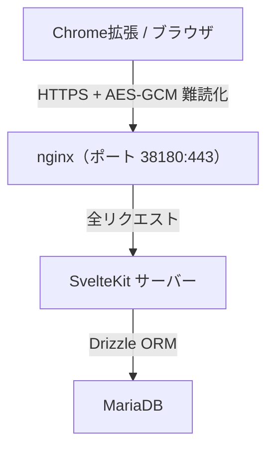
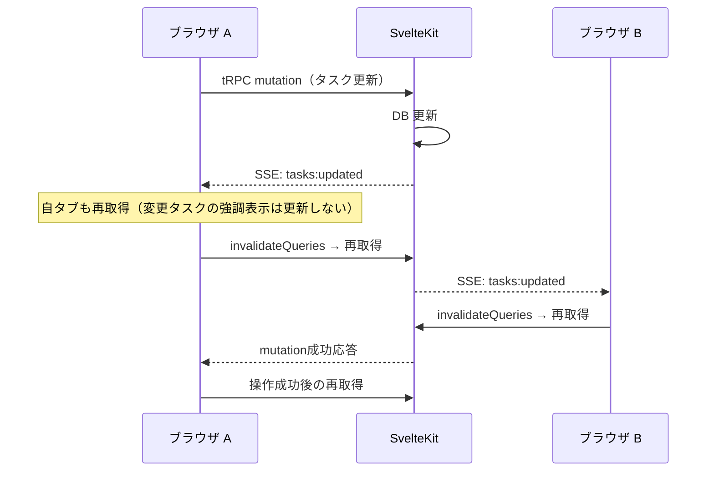
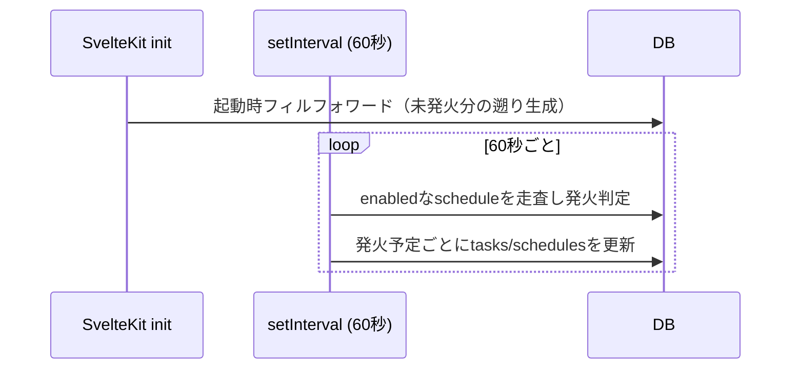

# アーキテクチャ

## アーキテクチャ図（Docker Compose 内部構成）



AES-GCMが保護する範囲は[通信の難読化](#通信の難読化)を参照。

## サーバーと画面の責務

`app/src/lib/server/trpc.ts`、MCPのツール、共有フォームは入力と認証を扱い、ドメインのoperationsへ処理を渡す。
operationsはapi層のDB操作、戻り値、更新通知をまとめる。
スケジューラーによる変更もoperationsを通して通知する。
これによりtRPC、MCP、フォーム、定期処理の通知が一致する。
api層はDB操作と所有権の確認を担当する。
複数の書き込みで成立する操作は、同じトランザクション内で実行する。

APIの入力と戻り値はcamelCaseを使う。
DB列名とCSV列名は保存形式として個別に扱う。
入力スキーマは`schemas.ts`へ集める。
値だけで判断できる制約は、入力スキーマを使って検証する。
所有権、関連行の存在、保存済み値と組み合わせる制約はapi層で検証する。
クライアントはtRPCの`RouterInputs`と`RouterOutputs`から型を推論する。

画面の共通クエリー定義はキーと取得処理をまとめ、SSEのイベント別に再取得対象を決める。
メイン画面はクエリー、操作、同期、URLとローカル保存、キーボード、ダイアログの状態を分ける。
翻訳画面は状態をcontrollerで管理し、ブラウザー内蔵AIの共有インスタンスの準備・取得・破棄はクライアントモジュールが担当する。

### 再評価をまたいで保持するサーバー状態

開発サーバーはコード更新のたびに同じNode.jsプロセスでサーバーモジュールを再評価する。
接続や発行済みの値をモジュール変数に置くと、再評価前に始まった接続や要求が旧世代の表に残り、再評価後の処理から到達できなくなる。
周期タイマーも評価のたびに増える。
このため、世代を越えて保持する状態は`app/src/lib/server/process-state.ts`の共通の所有機構で取得する。

- 保持するのは状態（表・カウンター・フラグ）と周期タイマーに限る。
  `processState`は名前ごとに`globalThis`上の値を返し、`processInterval`は名前ごとに1本のタイマーを保持して、評価のたびに呼び出す処理を最新の関数へ差し替える
- 業務処理は各モジュールの最新の評価に置く。再評価後の次の要求と次の周期は更新後のコードで動く
- 保持する対象はMCPのsession表と回収周期、SSEの接続・再送バッファ・採番、OAuthの認可コード、schedulerの起動済み・実行中・healthの状態とポーリング周期である。
  DB接続プールは`db.ts`が同じ方針で保持し、Drizzleのインスタンスは評価ごとに作成し直す
- OAuthの登録クライアントはファイルから再読込できるため、保持の対象にしない
- 本番では各モジュールが1回だけ評価されるため、保持の有無で挙動は変わらない
- 試験は`vi.resetModules()`と動的importで同じプロセス内に2世代を用意し、保持状態は`_resetProcessStateForTest`で試験ごとに破棄する

新しい常駐状態や周期処理を加える場合も同じ機構で取得する。

## リアルタイム同期（SSE）

mutation完了時にSSE (Server-Sent Events) で他タブ・他端末へ即座に通知する。



- エンドポイント: `GET /api/events`（Cookie認証）
- 利用者データは含めずイベント種別と送出元のタブIDを送信
 （`lists:updated` / `tasks:updated` / `timers:updated` / `schedules:updated` /
  `users:preferences:updated` / `calories:updated` / `reset`）
- クライアントはイベント受信時にTanStack Queryの `invalidateQueries` で該当データを再取得
- サーバーは送出元タブにも通知し、共有接続は全購読者へ配送する。
  メイン画面の`lists:updated`は送出元を区別せずリスト一覧を再取得する。
  `tasks:updated`も自タブを含めて再取得するが、自タブ発の場合は変更タスクの強調表示を更新しない
- 品目、記録または自動記録設定を変更した場合は`calories:updated`を通知し、受信側はカロリーページの全データを再取得する。
  目標値を変更した場合は既存の`users:preferences:updated`を通知し、カロリーページは目標値と期間集計を再取得する
- 接続の健全性はクライアント側で監視する。`EventSource`の自動再接続に加え、
  受信ウォッチドッグ（30秒周期で判定、最終受信から75秒経過で強制再接続）・
  `error`イベント発火時の`readyState=CLOSED`即時再接続・
  `visibilitychange`での可視復帰時の前倒し判定を組み合わせ、
  ブラウザのネットワークタイマー減速等で接続がゾンビ化した際の差分同期取りこぼしを防ぐ
- 接続・再送バッファ・イベントIDの採番は[再評価をまたいで保持するサーバー状態](#再評価をまたいで保持するサーバー状態)に置く。
  開発サーバーの再評価前に開いた接続へも、再評価後のoperationsの通知と`Last-Event-ID`による再送が届く
- nginx: `/api/events` に `proxy_buffering off` を設定（SSEがバッファされると配信遅延が発生するため）
- 検出と同期の役割を分離する。同期はSSEイベント受信時の再取得が担い、
  SSE応答が長期間届かない事態に備えてポーリングフォールバック機構を併設する。
  初回接続後10秒または受信途絶60秒で不健全と判定し、SSE経由で再取得対象となる全クエリーへ
  即時1回のフォールバック実行と30秒間隔の継続ポーリングを起動する。
  SSE側で何らかのイベントを受信した時点で健全へ復帰しポーリングを停止する。
  フォールバックはデータ再取得に専念し、リロード誘導は行わない。
  SSE接続自体はポーリング期間中も維持する
- 接続の不健全検出はSSEの受信途絶監視とは独立した仕組みが担う。`/healthcheck`へ能動的に問い合わせ、
  HTTPステータス200・`application/json`・本文の`status`値が`ok`の3点が揃った場合のみ健全と判断する。
  キャプティブポータルはステータス200で認証用HTMLを返すことがあるため、
  ステータスだけで判別せず`Content-Type`と本文の値まで確かめる。
  定期ポーリング（30秒間隔・非表示タブでは停止）に加え、可視復帰・オンライン復帰・
  SSE不健全遷移・操作失敗を前倒しトリガーとする。
  不健全検知時は、非入力中なら即時リロードして認証画面への遷移を促し、
  入力中ならバナーで案内し回復検知時に自動解除する
- 接続判定と検出トリガーは`app/src/lib/client/sse/connectivity-check.js`が定める。アプリ本体の
  `connection-recovery.svelte.ts`とService Workerが返すオフライン画面
  （`app/src/routes/offline.html/+server.ts`）が同じモジュールを使う。オフライン画面は、
  オフライン時に追加のスクリプトを取得できずキャッシュ対象を増やせないため、Viteの`?raw`で
  共有モジュールをインライン展開する

## 運用監視

`GET /healthcheck`はHTTP応答の生存確認とブラウザの接続回復に使う。
DB接続と定期処理の状態を監視する場合は`GET /healthcheck/ready`を使う。
この応答はキャッシュせず、利用者データや接続情報、例外詳細を含めない。

- DBの`SELECT 1`が2秒以内に成功し、定期処理が健全ならHTTP 200と`status: "ok"`を返す。
  それ以外はHTTP 503と`status: "error"`を返す
- `database`は`ok`か`error`、`scheduler.status`は`ok`、`starting`、`error`、`stale`を返す。
  `starting`は起動後の正常実行が未完了、`error`は直近の定期処理に失敗、
  `stale`は最後の正常実行から2ポーリング周期を超えた状態を表す
- `scheduler.last_success_at`と`last_finished_at`はUTCのISO8601文字列で、
  対応する実行がまだ無ければ`null`となる。個別の定期TODOやカロリー自動記録に失敗した場合も、その周期を正常実行として扱わない。
  他の予定の処理は継続し、次の正常な周期で健全へ戻る
- HTTP 503の応答は`next_action`に、DBの不健全を優先して状態ごとの確認先（`make ps`、`make logs`、`make logs-app`の`[scheduler]`行、`make restart-app`）を返す

DBが不健全な場合はDBの稼働状況を、定期処理が不健全な場合はアプリの`[scheduler]`ログを確認する。
運用監視による障害検知とコンテナーの生存確認を分け、DB障害だけでアプリの再起動を繰り返さない。

## タイマー時刻同期

タイマーの残り時間をブラウザで正確に計算するため、サーバーとの時刻差（オフセット）を管理する。

### オフセット計算

tRPCレスポンスでRTT/2補正付きの精密なオフセットを計算する:

```text
offset = serverTime - (requestStart + requestEnd) / 2
```

### オフセット更新の流れ

```text
SSE connected (初回接続)  ──→ setServerOffset(暫定値)
tRPC response (1分間隔)   ──→ setServerOffset(RTT/2補正値)
tRPC response (SSEイベント後) → setServerOffset(RTT/2補正値)
SSE heartbeat (30秒ごと)  ──→ 接続維持のみ（オフセット更新なし）
```

SSEは片道通信のためRTTを測定できない。heartbeatのサーバー時刻でオフセットを上書きすると、
tRPCのRTT/2補正で得た精密値が片道遅延分だけズレた値に劣化するため、heartbeatは接続維持のみに使用する。

heartbeatの送出形式には名前付きイベント（`event: heartbeat`）を採用する。
コメント行形式（`:\n\n`）では`EventSource`がイベントとして通知せず、
クライアント側の受信ウォッチドッグが`addEventListener("heartbeat", ...)`で
最終受信時刻を更新できない。

## 定期処理スケジューラー

`schedules`テーブルのRRULE（`app/src/lib/server/schema.ts`）を起点に、
サーバー内`setInterval`が定期的にTODOタスクを自動生成する。実装は`app/src/lib/server/scheduler.ts`。



- 起動時と定期ポーリングの双方でfill-forward方式を採用する。
  各スケジュールの`last_fired`（未設定時は`created`）を起点に、現在時刻までの未発火分を遡って生成する
- fill-forwardは`rrule`のiteratorで発火予定を1件ずつ取り出し、
  上限30件に達した時点で走査を打ち切る。
  長期未発火の日次スケジュールでも全発火予定を配列化せずメモリ使用量を抑える
- 上限30件を超える発火予定は31件目以降を生成せずスキップする。
  この方式は上限の範囲内で重複発火を許容する設計であり、
  上限を超えるフィルフォワードでは一部の発火予定が生成されずに終わる場合がある
- 全発火予定の生成後に1回、`rule.before(now, true)`で求めた直近の発火予定を対象スケジュールの`last_fired`へ設定し、次回ポーリングでの再検出（二重発火）を防ぐ
- 起動済み・実行中・healthの状態とポーリング周期は[再評価をまたいで保持するサーバー状態](#再評価をまたいで保持するサーバー状態)に置く。
  開発サーバーの再評価後に`init`が再び呼ばれても周期は増えず、排他と`/healthcheck/ready`は同じ実行を表し、次の周期は更新後の処理を呼ぶ
- 発火機構は単一プロセスを前提とする。
  現行のDocker Compose構成はアプリケーションサーバーが単一プロセスであるため、
  複数プロセスワーカー間の発火競合は考慮しない。
  複数プロセス構成へ拡張する場合、同一スケジュールへの並行発火は
  `list.user_id`と`last_fired`の更新競合により上記の重複許容範囲に収まる
- スケジュールの`rrule`列は`DTSTART;TZID=Asia/Tokyo`形式でタイムゾーンを保持する。
  `rrule`の`between()`が返す`Date`はAsia/Tokyoのローカル時刻をUTCとしてマークした値であるため、
  市民時刻の時・分の取り出しには`getHours()`ではなく`getUTCHours()`等のUTC系アクセサを使う
- 発火予定の計算はアプリのプロセスの時刻帯に依存しない。
  `rrule`は`tzid`を指定すると、プロセスの時刻帯の壁時計の時刻をUTCの成分に持つ日時で境界を受け取り結果を返すため、
  `scheduler.ts`は`between()`と`before()`へ渡す境界をその表現へ変換し、返った日時を真の時刻へ戻してから比較と`last_fired`の保存に使う。
  本番イメージは`TZ=Asia/Tokyo`、開発用のappと試験のコンテナーはUTCで動くため、`make test-db`はnode projectを両方の時刻帯で実行する

同じポーリングでカロリーの自動記録も処理する。

- 各設定は次に記録する時刻を`calorie_auto_record.next_run_at`（UTC）に持つ。
  ONの設定のうち`next_run_at`が現在時刻以前のものは、そこから1日刻みで現在時刻以前の時刻ごとに記録を追加し、
  `next_run_at`を現在時刻より後の最初の時刻へ進める。記録を追加した利用者へ`calories:updated`を通知する
- 設定の作成・変更（ON/OFFの切替を含む）のたびに`next_run_at`を現在時刻より後へ置き直す。
  OFFの間に過ぎた時刻をONへ戻した時に遡って記録しないためである

## 認証設計

CookieベースのJWT/HS256セッション。実装詳細は `hooks.server.ts` / `session.ts` を参照。

セッションJWTは専用の`aud`で用途を限定する。署名・期限が有効な既存の`aud`無しセッションは受理し、
同じ署名鍵を使うMCPのアクセストークン・リフレッシュトークンと未知の用途のJWTはブラウザ認証で拒否する。

### CSRF 対策

多層防御を採用している。

- SvelteKit組み込み機能でform actionを保護
- `hooks.server.ts`で`sec-fetch-site`が`cross-site`の`/api/*`への更新要求を拒否する（Fetch Metadataによる判定）
- ログアウトをPOSTに限定（GETリクエストによるCSRFを防止するため）

Chrome拡張のポップアップ内iframeからのアクセスを許可する必要があるため、
Cookieに `sameSite: "none"` + `secure: true` を設定している。
この設定に伴うクロスサイト要求は、上記のFetch Metadata判定で制限する。

認証の必要な画面とAPIは`hooks.server.ts`で保護し、未認証の場合は画面のログイン誘導とAPIの認証エラーを使い分ける。
認証画面、OAuthの公開エンドポイント、ヘルスチェックなどは公開ルートの定義に従う。
tRPCはユーザーデータを扱う全手続きを`encryptedProcedure`で定義する。
MCPはBearerトークンで認証し、不明なセッションIDへのPOSTは404とする。
MCPセッションは24時間使われなければ破棄する。
MCPのsession表と無活動sessionの回収周期、OAuthの認可コードは[再評価をまたいで保持するサーバー状態](#再評価をまたいで保持するサーバー状態)に置く。
開発サーバーの再評価後も、開始済みのsessionへのPOST・GET・DELETEと発行済みの認可コードの消費が成立する。
回収周期は1本で、明示停止は周期の取消と保持中のtransportの終了を対にする。
OAuthのクライアント秘密値は共通の認証処理で比較する。
認可の許可、拒否、エラーのリダイレクトは、登録済みクライアントとリダイレクト先を確認してから組み立てる。

## 通信の難読化

HTTPSを通信の保護に使い、AES-GCMはtRPCの本文を追加で難読化する。
対象はmutationの要求本文と、`encryptedProcedure`の全手続きの応答である。
クエリーの入力はGETのURLに含まれるため、検索語などは平文となる。
クライアント側の暗号化に失敗した場合は平文の入力で送信し、サーバーもその入力を受け付ける。
暗号化処理の失敗だけで操作不能になることを避けるための扱いであり、アクセス制御はセッションと所有権の確認が担当する。

## tRPCミドルウェア設計

tRPC v11のミドルウェア（`t.middleware`）内で下流のprocedureが送出した例外を捕捉するには、
`try/catch` ではなく `await next()` の戻り値の `result.ok` を判定する。
tRPC v11の `next()` は例外を再送出せず `{ok: false, error}` で返す仕様のため、
`try/catch` 側は到達しない。

実例は `app/src/lib/server/trpc.ts` の `withApiErrors` にある。
同ミドルウェアは型付きの`ApiError`を共通の対応表から日本語の文言とエラー分類へ変換する。
未知の例外はログへ記録し、応答には内部の例外詳細を含めない。
Zodの入力エラーはerrorFormatterが構造化して返し、クライアントがmessage文字列のJSONを解析する処理に依存しない。
要点を簡略化すると次の形になる。

```ts
const withApiErrors = t.middleware(async ({ next }) => {
  const result = await next();
  if (!result.ok) {
    // result.error を検査してマッピングする
  }
  return result;
});
```

`withEncryption` も同じ `result.ok` パターンを使う。
新しいミドルウェアを追加・改修する際は同じ判定形式に揃える。

## DB 設計方針

テーブル定義は `app/src/lib/server/schema.ts` を参照。以下はコードから読み取りにくい設計判断:

- `task.status`は`active`・`running`・`completed`・`archived`の4値を取り得る。
  `running`は未完了としてTODOバッジへ計上し、`lists.clear`（完了済みタスクの非表示）の対象外とする

- 日時カラムはTIMESTAMP型でUTC保存し、APIではISO8601文字列で返す
- カロリー入力の現地時刻と日付は`tzOffsetMinutes`でサーバーがUTCへ変換する。日ごとの達成状況と今日の残量は現地の早朝4時を日境界とする
- 定期TODOは`Asia/Tokyo`を使用し、RRULE文字列に`DTSTART;TZID=Asia/Tokyo`形式で保持する
- タスクとタイマーの並び順は `sort_order` INTカラム（昇順、1000刻み）。刻み幅を大きくすることで、挿入時に周囲のレコードを更新せずに済む。
  タスク（`tasks.create`）は `sort_order = 既存最小値 - 1000` で先頭挿入、
  タイマー（`timers.create`）は `sort_order = 既存最大値 + 1000` で末尾追加
- リスト（`lists.create`）も `sort_order = 既存最小値 - 1000` を保存するが、
  リスト一覧（`lists.list`）は `title` の昇順で返す
- タイマー一覧の取得ではサーバーが残り秒数を計算し、期限切れを停止する。
  クライアントは`remainingSeconds`、`startedAt`、`serverTime`から表示中の残り時間を計算する。
  秒単位の表示更新にはポーリングを使わない
- タイマーの `ephemeral` カラムは1回限り使用するタイマーを識別するフラグ。
  作成時のみ設定でき、`adjust` / `reset` / `setTime` などの操作で変更されない。
  クライアント側では満了到達時に削除ボタンを強調し、確認ダイアログを省略して削除できる体験に用いる
- カロリー計算では、品目を利用者内で一意に保持し、記録は品目IDを参照する。
  品目名またはkcalを変更すると、既存記録の表示と期間集計へ反映される。
  品目表へ登録しない一時項目の記録は品目IDを持たず、名前（`temporary_name`）とkcal（`quantity`）を記録自身が持つ。
  品目IDと一時項目名はどちらか一方だけを持つ。
  MariaDBは`ON UPDATE CASCADE`の外部キー列をCHECK制約に使えないため、この不変条件は書き込み側で守る。
  記録の一覧と集計は品目を外部結合し、品目を参照しない一時項目の行も結果へ含める
  kcal、数量および1日当たり目標値は整数で保持する。
  利用者ごとの1日当たり目標値は`users.preferences.calorieGoalKcal`へ保持する
- カロリーの自動記録設定（`calorie_auto_record`）は現地の時刻`time_of_day`と登録時の`tz_offset_minutes`を組で保持する。
  他のカロリー入力と同じく固定の時差で解釈するため、夏時間の切り替えには追随しない

list、task、timer、attachment、scheduleの親列は索引と`ON DELETE RESTRICT`・`ON UPDATE RESTRICT`の外部キーで関連を保つ。
親を削除する処理は子を先に削除する。
削除対象が無い場合や他のユーザーの行の場合は変更せず成功する。
更新や取得で必要な行が無い場合のエラーとは区別する。
status、kind、modeはvarcharの列へ保存し、TypeScriptの列型と入力スキーマの列挙値を合わせる。
既存環境の外部キー名と索引名の違いはマイグレーションで解消し、定義とsnapshotと実DBを合わせる。

### バイナリ保存と `max_allowed_packet`

`mediumblob`・`longblob` カラムへバイナリを保存する場合、
drizzle-orm mysql2ドライバーの `db.transaction` は
内部で `client.query()`（テキストプロトコル）を採用する。
`Buffer` パラメーターは16進数リテラルへ変換されて送信されるため、
実バイト数の約2倍のSQLテキストがサーバーへ送信される。
`db/my.cnf` の `max_allowed_packet` は元の想定バイナリサイズの3倍以上に設定する
（現行値は `64M`）。添付ファイル上限が10 MiBのため、
テキスト膨張とプロトコルオーバーヘッドを吸収する余裕を確保している。
新しいBLOB系カラムを追加する場合は同基準で再点検する。
