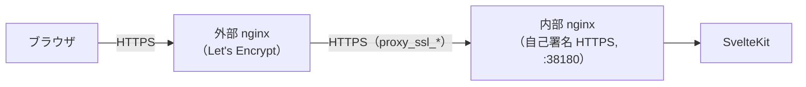

# はじめに

自分のサーバーへGLATasksをデプロイする手順。

## デプロイ

### 前提条件

- Docker / Docker Composeがインストールされたサーバー
- HTTPS環境（リバースプロキシ等）

### 手順

1. リポジトリをクローン

   ```bash
   git clone https://github.com/ak110/GLATasks.git
   cd GLATasks
   ```

2. `.env`を作成（`.env-example`を参考に）

   ```bash
   cp .env-example .env
   ```

   `DATA_DIR`にデータ保存先ディレクトリのパスを設定する（`COMPOSE_PROFILE`は`production`を推奨）

3. 起動

   ```bash
   make deploy
   ```

4. HTTPSでアクセスできるようリバースプロキシを設定
  （設定例は[外部リバースプロキシ設定](#外部リバースプロキシ設定)を参照）

5. ブラウザでアクセスし、ユーザー登録してログイン

### 停止

```bash
make stop
```

### 更新

最新版に更新する場合:

```bash
git pull
make deploy
```

## 外部リバースプロキシ設定

Docker Composeの前段にLet's Encrypt証明書でHTTPS終端する外部nginxを配置する場合の設定要点。



設定上の制約:

- 内部nginxは自己署名HTTPSのため、`/api/events`と`/`の両方に
 `proxy_ssl_certificate` / `proxy_ssl_certificate_key`を指定する
- SSE用の`/api/events`には`proxy_buffering off`に加え`proxy_read_timeout 86400`・
 `proxy_http_version 1.1`・`Connection ''`を指定する。
  さらに`X-Accel-Buffering: no`ヘッダーでレスポンスバッファも無効化する
（SSEがバッファされると配信遅延が発生するため）

最小サンプル（要点のみ）:

```nginx
location /api/events {
    proxy_pass https://app_backend;
    proxy_http_version 1.1;
    proxy_set_header Connection '';
    proxy_ssl_certificate     /path/to/glatasks/web/ssl/server.crt;
    proxy_ssl_certificate_key /path/to/glatasks/web/ssl/server.key;
    proxy_buffering off;
    proxy_read_timeout 86400;
    add_header X-Accel-Buffering no;
}

location / {
    proxy_pass https://app_backend;
    proxy_ssl_certificate     /path/to/glatasks/web/ssl/server.crt;
    proxy_ssl_certificate_key /path/to/glatasks/web/ssl/server.key;
}
```

`Host` / `X-Forwarded-For` / `X-Forwarded-Proto`等の標準ヘッダーは通常通り設定する。
