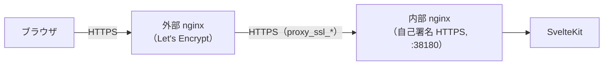

# はじめに

自分のサーバーへGLATasksをデプロイする手順。

## デプロイ

### 前提条件

- Docker / Docker Composeがインストールされたサーバー
- HTTPS環境（リバースプロキシ等）

### 手順

1. リポジトリをクローン

   ```bash
   git clone https://github.com/ak110/GLATasks.git
   cd GLATasks
   ```

2. `.env`を作成（`.env-example`を参考に）

   ```bash
   cp .env-example .env
   ```

   `DATA_DIR`にデータ保存先ディレクトリのパスを設定する（`COMPOSE_PROFILE`は`production`を推奨）

3. 起動

   ```bash
   make deploy
   ```

4. HTTPSでアクセスできるようリバースプロキシを設定
  （設定例は[外部リバースプロキシ設定](#外部リバースプロキシ設定)を参照）

5. ブラウザでアクセスし、ユーザー登録してログイン

### 停止

```bash
make stop
```

### 更新

最新版に更新する場合:

```bash
git pull
make deploy
```

## 登録・ログインとパスキー

登録画面では、ユーザーID（4～32文字の英数字）とパスキーだけで登録できる。
従来のパスワード登録も選べる。
パスキーの操作には、HTTPSと対応するブラウザー・端末が必要だ。
ログイン画面の「パスキーでログイン」ではユーザーIDを入力せず、ブラウザーが示すパスキーを選ぶ。

パスキーだけで登録した直後は、表示された10個の復旧コードをパスワードマネージャーなどへ保存する。
コードは再表示できず、各コードは1回だけ使える。
保存の確認後に元の画面へ進む。

ヘッダーの「セキュリティ」から、パスキーの追加・名前変更・削除と登録日・最終利用日時の確認ができる。
認証手段を変更するたびに、有効なパスキーか現在のパスワードで本人確認する。
パスワードの無効化には、登録済みパスキーでの本人確認と新しい復旧コードの保存確認が必要だ。
パスワードが無い間は最後のパスキーを削除できない。
同じ設定画面からパスワードを設定し直せる。
復旧コードの再発行は以前のコードを無効にする。

パスキーを全て失った場合は、ログイン画面の「パスキーを失った場合の復旧」でユーザーIDと未使用の復旧コードを入力する。
本人確認後15分以内に新しいパスキーを登録する。
中断した場合は同じブラウザーの復旧画面から「本人確認済みの登録を再開」を選べる。
期限が過ぎた場合は別の未使用コードで始める。
復旧が完了すると以前のパスキー・復旧コード・ログイン済みのブラウザーセッションが無効になるため、新しいコードを保存する。
連続して本人確認に失敗した場合は15分待ってから入力を確認して再試行する。

Chrome拡張の埋め込み画面では「新しいタブで認証する」を選ぶ。
新しいタブで認証した後に元の共有画面を開き直すと、ログイン状態を引き継げる。
操作の取消や期限切れでは開始ボタンからやり直せる。
非対応の環境では対応ブラウザーかパスワードを使う。

## 外部リバースプロキシ設定

Docker Composeの前段にLet's Encrypt証明書でHTTPS終端する外部nginxを配置する場合の設定要点。



設定上の制約:

- 外部nginxの`client_max_body_size`を内部nginx・アプリの上限（32MiB）にそろえる。
  添付ファイルはbase64へ変換したうえで、要求本文の入力全体をさらにbase64でエンコードして送るため、
  nginxの既定値（1MiB）のままでは元のファイルで約575KiBを超える添付が外部nginxの413（Content Too Large）で失敗する
- 内部nginxは自己署名HTTPSのため、`/api/events`と`/`の両方に
 `proxy_ssl_certificate` / `proxy_ssl_certificate_key`を指定する
- SSE用の`/api/events`には`proxy_buffering off`に加え`proxy_read_timeout 86400`・
 `proxy_http_version 1.1`・`Connection ''`を指定する。
  さらに`X-Accel-Buffering: no`ヘッダーでレスポンスバッファも無効化する
（SSEがバッファされると配信遅延が発生するため）

最小サンプル（要点のみ）:

```nginx
client_max_body_size 32m;

location /api/events {
    proxy_pass https://app_backend;
    proxy_http_version 1.1;
    proxy_set_header Connection '';
    proxy_ssl_certificate     /path/to/glatasks/web/ssl/server.crt;
    proxy_ssl_certificate_key /path/to/glatasks/web/ssl/server.key;
    proxy_buffering off;
    proxy_read_timeout 86400;
    add_header X-Accel-Buffering no;
}

location / {
    proxy_pass https://app_backend;
    proxy_ssl_certificate     /path/to/glatasks/web/ssl/server.crt;
    proxy_ssl_certificate_key /path/to/glatasks/web/ssl/server.key;
}
```

`Host` / `X-Forwarded-For` / `X-Forwarded-Proto`等の標準ヘッダーは通常通り設定する。
